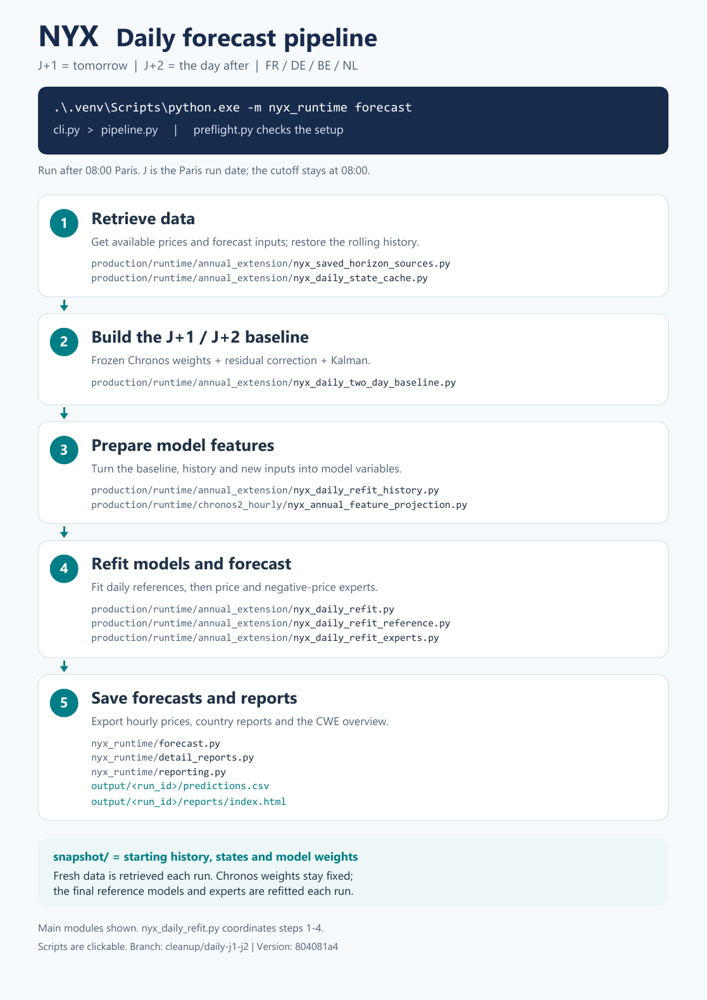

# NYX — daily J+1/J+2 forecasts

Hourly electricity price forecasts on **CPU** for **FR, DE, BE and NL**.
One command produces **J+1 (tomorrow)** and **J+2 (the day after)**, using a common
forecast origin of **08:00 Europe/Paris today**, including daylight-saving changes.

## How it works

[](docs/daily-pipeline.pdf)

*Click the diagram to open the PDF; its script names link to the code.*

The bundled **`snapshot/`** contains starting history, states, saved models and
Chronos weights. Each run retrieves fresh inputs from the work data sources.
Chronos weights stay fixed; the final reference models and experts are refitted daily.

## Run a forecast

On a new laptop, complete **First-time setup** below first. Then, in PowerShell,
from the repository folder, **after 08:00 Paris**:

```powershell
.\.venv\Scripts\python.exe -m nyx_runtime forecast
```

This runs both horizons, all four countries and the reports. Starting later is fine:
the forecast origin stays at 08:00 Paris. Run only one task at a time per repository copy.

A successful run returns **exit code 0**, **`state: COMPLETE`** and
**`new_predictions_computed: true`**.

```text
output/
├── latest.json                 Paths for the latest fully successful run
└── <run_id>/
    ├── status.json             Run status and diagnostics
    ├── predictions.csv         J+1/J+2 prices for the four countries
    ├── native_forecasts/       Country CSVs and negative-price probabilities
    └── reports/index.html      Open this to view the reports
```

`predictions.csv` includes `zone`, `delivery_day`, `delivery_start_utc`,
`forecast_origin_utc`, `horizon_day` and `prediction_eur_mwh` (EUR/MWh).
After a failed run, `latest.json` still points to the previous success: check its date.

<details>
<summary><strong>First-time setup</strong></summary>

You need **Python 3.11 (64-bit)**, **Git with Git LFS**, corporate Saturn access,
and the team's approved **`tshistory_lite==0.5`** client. Install Saturn in this
repository's `.venv`, even if it is already installed elsewhere on the laptop.

Use **Git clone**, not Download ZIP. Clone into a short path such as `C:\NYX\code`.
The bundled snapshot is about **1.6 GB**. Place the approved Saturn wheel at
`C:\NYX\tshistory_lite-0.5-py3-none-any.whl`, then run these commands in PowerShell,
stopping if any command fails:

```powershell
Set-Location C:\NYX\code
git lfs install --local
git lfs pull
py -3.11 -m venv .venv
.\.venv\Scripts\python.exe -m pip install torch==2.11.0 --index-url https://download.pytorch.org/whl/cpu
.\.venv\Scripts\python.exe -m pip install -r requirements.txt C:\NYX\tshistory_lite-0.5-py3-none-any.whl
.\.venv\Scripts\python.exe -m pip check
$env:SATURN_AUTHOR = Read-Host 'Your professional Saturn identifier'
[Environment]::SetEnvironmentVariable('SATURN_AUTHOR', $env:SATURN_AUTHOR, 'User')
.\.venv\Scripts\python.exe -m nyx_runtime preflight
```

`SATURN_AUTHOR` is your professional identifier, **not a password**. Authentication
is handled by the company Saturn client. Keep this PowerShell window for the first
run; open future windows from the Start menu to load the saved variable.

Run `preflight` after 08:00 Paris. Expect `No broken requirements found` from
`pip check` and `ready: true` from `preflight`. Preflight checks local files and
versions; access to live sources is checked during the forecast.

Defaults are `snapshot/` for inputs and `output/` for results. To change them,
copy `config.example.json` to `config.local.json`, edit the paths and add
`--config config.local.json` to the preflight and forecast commands.

</details>

<details>
<summary><strong>Troubleshooting and state files</strong></summary>

- **Run blocked:** read `blockers` or the run's `status.json`. Before 08:00 Paris, wait.
- **Missing LFS file or incorrect checksum:** run `git lfs pull`. If it persists,
  restore the original files; do not edit their verification receipts.
- **Wrong dependency version:** reinstall the pinned `requirements.txt` in `.venv`.
- **Saturn unavailable:** check the client in `.venv`, `SATURN_AUTHOR`, corporate
  network access and authentication.
- **State too old or incompatible:** obtain a newer compatible snapshot. The bundled
  states use the **22 October 2026** cutoff; continuation accepts at most **seven missing days**.

Keep `snapshot/` unchanged. Back up the evolving states and captures in
`production/runtime/runs/` and `production/runtime/data/`; these working files,
credentials and new run outputs stay outside Git.

The final model's forecast bounds are indicative and uncalibrated. The model
qualification flag remains **`qualified_for_production: false`**.

</details>
