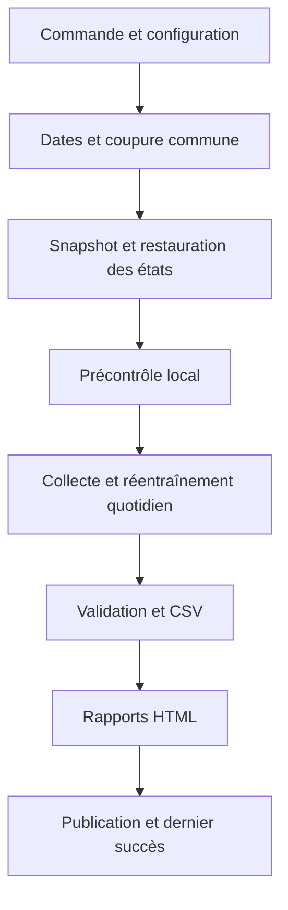

# Architecture de la chaîne J+1/J+2

Le dépôt opérationnel produit les prévisions CPU pour FR, DE, BE et NL, leurs
CSV et trois rapports HTML : un rapport par livraison et une vue combinée.
Le point d’entrée est `python -m nyx_runtime`.

## Lire le dépôt

| Emplacement | Responsabilité |
| --- | --- |
| [`nyx_runtime/`](../nyx_runtime/) | Application maintenable : configuration, orchestration, contrôles, CSV, HTML et stockage. |
| [`production/runtime/`](../production/runtime/) | Noyau scientifique conservé avec les identités nécessaires aux modèles et états existants. |
| [`production/SOURCE_MANIFEST.json`](../production/SOURCE_MANIFEST.json) | Provenance et empreintes des fichiers du noyau. |
| [`tests/`](../tests/) | Contrats de données, calculs horaires, orchestration et non-régression. |
| [`deploy/aws/`](../deploy/aws/) | Ressources AWS et déploiement. |
| [`Dockerfile`](../Dockerfile) | Environnement Linux CPU reproductible. |

Les anciennes interfaces, campagnes de recherche et copies de scripts restent
consultables dans Git. La version antérieure est conservée sur
`refactor/aws-daily-forecasts`, au commit
`f215e66fe93ba0d1ebe6c7c0ddc3900042da82a7`. La réorganisation est portée par
`refactor/readable-j1-j2`.

## Parcours d’un calcul

Le précontrôle inspecte les entrées, les dépendances et les états compatibles.
Les fournisseurs distants sont interrogés pendant le calcul. Les observations
collectées pour les comparaisons des rapports ont une provenance distincte des
entrées des modèles.

| Module | Quand le modifier |
| --- | --- |
| [`cli.py`](../nyx_runtime/cli.py) | Ajouter ou modifier une commande et ses arguments. |
| [`settings.py`](../nyx_runtime/settings.py) | Faire évoluer la configuration opérationnelle et la résolution des chemins. |
| [`planning.py`](../nyx_runtime/planning.py) | Travailler sur la définition des dates et la représentation des journées physiques. |
| [`pipeline.py`](../nyx_runtime/pipeline.py) | Modifier l’ordre des étapes, les statuts et les conditions de publication. |
| [`runtime.py`](../nyx_runtime/runtime.py) | Modifier la vérification des sources, le verrou local ou la restauration des états. |
| [`engine.py`](../nyx_runtime/engine.py) | Modifier les contrôles communs des artefacts et le chargement du noyau. |
| [`preflight.py`](../nyx_runtime/preflight.py) | Ajouter un contrôle préalable ou rendre un blocage plus explicite. |
| [`forecast.py`](../nyx_runtime/forecast.py) | Modifier l’adaptation du producteur et la validation de ses prévisions natives. |
| [`reporting.py`](../nyx_runtime/reporting.py) | Modifier le schéma CSV partagé, la présentation ou le rendu HTML. |
| [`templates/report.html`](../nyx_runtime/templates/report.html) | Modifier le HTML, le CSS et les interactions du rapport. |
| [`snapshot.py`](../nyx_runtime/snapshot.py) | Faire évoluer l’export et l’inventaire des entrées. |
| [`storage.py`](../nyx_runtime/storage.py) | Modifier les transferts S3, les verrous et la publication des états/résultats. |

## Contrat de prévision

Une émission au jour J utilise la coupure **J à 08 h, Europe/Paris** pour les
deux livraisons J+1 et J+2. La coupure de J+2 reste celle de J. Les index internes
sont en UTC ; chaque livraison correspond à une journée civile à Paris. Une
journée de changement d’heure contient donc 23 ou 25 heures physiques.

Le producteur réentraîne les modèles prévus par la recette quotidienne. Les
contrôles exigent les quatre pays, les deux livraisons complètes, une origine
commune et l’absence de labels futurs. Les poids de fondation Chronos sont
réutilisés en CPU ; ils ne sont pas réentraînés par ce parcours.

Le schéma des CSV est défini une fois dans `reporting.CSV_COLUMNS`. Le CSV
canonique et les CSV natifs sont conservés avec leurs reçus. Sur S3,
`_SUCCESS.json` atteste la publication d’un lancement complet. Le pointeur du
dernier succès est mis à jour après la production des rapports et leur
publication.

## Pourquoi conserver 92 fichiers scientifiques ?

Le manifeste sélectionne **86 fichiers Python et six configurations**.
Quatre-vingts fichiers participent au chemin d’appel retenu. Les douze autres
restent nécessaires aux empreintes ou à la reprise : six configurations,
plusieurs sources historiques et l’outil de reprise de l’horizon sauvegardé.
Le manifeste précise ce motif pour chaque fichier.

Ces fichiers portent les namespaces historiques utilisés dans les modèles
sérialisés. Les états comparent également les empreintes du code, des
configurations, des poids et les versions des bibliothèques. Leur conservation
permet de contrôler la compatibilité avec les artefacts existants. Un changement
scientifique demande une nouvelle version de recette et ses propres artefacts ;
la procédure est décrite dans [le guide de développement](development.md).

## Limites de validation

Les tests couvrent les contrats et l’orchestration, avec des producteurs simulés
aux frontières externes. Ils ne démontrent pas un réentraînement réel avec le
SDK privé Saturn, les données privées et les états exportés, ni un déploiement
AWS effectif. Le précontrôle sur la plateforme cible reste nécessaire.

La recette conserve `qualified_for_production: false`. L’enveloppe
`baseline_envelope_uncalibrated` est indicative et ne constitue pas un
intervalle calibré du prix final.
